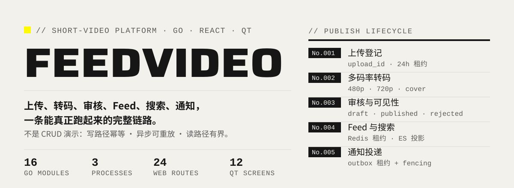
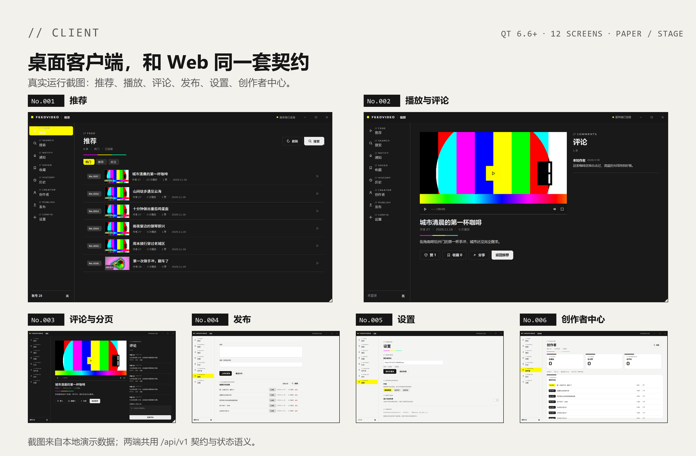
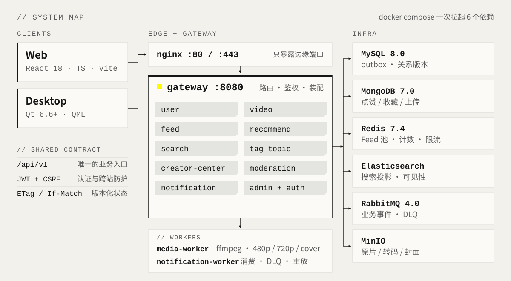
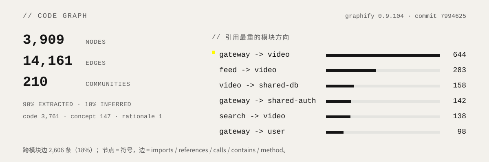

<p align="center">
  
</p>

<p align="center">FeedVideo 是一个可直接运行的短视频平台：上传、转码、审核、Feed、搜索、互动、通知、创作者中心，一条完整链路。</p>

## 能跑起来的样子

<p align="center">
  
</p>

Qt 6.6+ 桌面客户端，paper / stage 双主题；Web 端使用同一套 `/api/v1` 契约、配色与排版规范。截图来自本地演示数据。

## 这不是 CRUD 演示

三个写清楚的地方，都能在代码里找到对应实现。

- **写路径有幂等键和版本。** 发布带 `Idempotency-Key` 与 `upload_id`：同作者、同 key、同内容返回最初的 `video_id`，内容不同返回 409。点赞与收藏用 `PUT` 提交显式终态，可带 `If-Match: <version>`；版本落后返回 409 与当前状态和 `version`，成功响应带 ETag。
- **异步路径可重放。** 事件先落 `outbox_events`，relay 用 `SELECT … FOR UPDATE SKIP LOCKED` 领取并写入 `claimed_at / lease_until`，用 `claim_token` 做 fencing；进程崩溃后租约过期可被其他实例重领。管理端另有 outbox 重放、媒体 DLQ 重放、通知 DLQ 重放三个入口。
- **读路径有界。** Feed 构建持 Redis 租约并受预算约束，租约过期由其他实例接手；搜索先取当前候选，再按可见性过滤，入口按用户与 IP 限流。

这些机制默认不全部打开：`LIKE_STATE_MODE` 与 `SEARCH_PROJECTION_MODE` 缺省为 `legacy`，切换前需要回填与对账。见[边界](#边界与未完成)。

## 系统怎么组装

<p align="center">
  
</p>

| 进程 | 职责 |
| --- | --- |
| `gateway` | HTTP 入口、鉴权、限流、依赖装配、outbox relay、Swagger |
| `media-worker` | 拉取上传对象，ffmpeg 转 480p / 720p 并生成封面，失败重试与 DLQ |
| `notification-worker` | 消费通知事件并落库，支持 DLQ 重放 |

## 代码图谱

仓库里随版本提交了一份代码知识图谱：[graphify-out](./graphify-out)。3,909 个节点、14,161 条边、210 个社区；节点是符号（类型、函数、组件），边按 `imports / references / calls / contains / method` 建立，90% 直接抽取、10% 为推断。

它回答的是「改这里会波及什么」：`gateway → video` 有 644 条引用边，`feed → video` 283 条、`search → video` 138 条。改 `video` 的模型时，这些就是第一批要看的调用方。

<p align="center">
  
</p>

- `graph.json` 是原始图，可以直接用脚本查节点与邻居。
- `graph.html` 是可视化浏览器，vis-network 从 CDN 加载（需要联网）；GitHub 只显示 HTML 源码，要克隆后本地打开。
- 代码改动后用 `graphify update .` 重新生成（无 API 费用）。
- 抽取以 AST 为主：35 个 `.qml` 文件未入图，桌面端的 QML 结构不在图谱里。

## 快速开始

前置：Go 1.25.1+、Node.js 24、Docker Compose v2；桌面端另需 Qt 6.6+。

1. 生成开发配置（已存在且非生产标记时不会覆盖）：

   ```powershell
   pwsh -NoProfile -File deployments/init-dev.ps1
   ```

2. 编译 Compose 需要的三个二进制：

   ```powershell
   pwsh -NoProfile -File deployments/build-backend.ps1
   # Linux / macOS：用 build-gateway.sh 代替上面一行，同样产出三个二进制
   bash deployments/build-gateway.sh
   ```

3. 启动依赖与应用，等就绪探针通过：

   ```powershell
   cd deployments
   docker compose -f docker-compose.yml -f docker-compose.dev.yml up -d --build
   curl.exe --fail http://localhost:8080/readyz
   ```

4. 打开 `https://localhost`（开发自签证书）。API 文档在开发编排暴露的 `http://localhost:8080/swagger/index.html`。

前端热更新与桌面端：

```powershell
cd frontend && npm ci && npm run dev
bash desktop/build.sh run   # 需要 QT_ROOT / QT_NINJA，默认指向 Qt 6.9.1 + MinGW 13.1
```

## 目录

| 位置 | 用途 |
| --- | --- |
| `gateway` | HTTP 入口、依赖装配、调度器与媒体 worker |
| `user` `video` `feed` `recommend` | 账号、内容、Feed 与推荐 |
| `search` `tag-topic` `creator-center` `moderation` | 搜索、话题、创作者与治理 |
| `notification` | 通知业务与异步消费 |
| `shared-*` | 认证、配置、数据库、事件、消息队列、对象存储 |
| `frontend` | React 18 + TypeScript + Vite，24 条路由 |
| `desktop` | Qt 6.6+ / QML 桌面客户端，12 个 QML 屏 |
| `deployments` `migrations` | Compose 编排、运维脚本与数据库迁移 |
| `graphify-out` | 代码知识图谱：`graph.json` 与可视化浏览器 `graph.html` |

## 边界与未完成

- **发布子集。** 本仓库不含 `tests/`、`scripts/`、根目录 `docs/` 与 CI 工作流，回归与验收脚本不在其中；设计与验收文档将在后续版本补齐。
- **两种模式未默认启用。** 点赞事实源与搜索投影各有 `legacy` / 新模式，切换需要索引门禁、回填、对账与回滚预案，不能只改环境变量。
- **凭据。** 仓库只提供 `.env.example` 模板，生产值通过 Secret 注入。提交前请确认没有真实凭据被跟踪：`.gitignore` 对已经被跟踪的文件不生效。

## 许可

[MIT](./LICENSE) © 2026 djqts。可自由使用、修改、分发与商用，保留版权与许可声明即可。

内置字体 Saira 与 FeedVideoSans 按各自的 SIL OFL 1.1 授权，见 `desktop/assets/fonts/` 与 `frontend/public/fonts/` 下的 `*-OFL.txt`。

